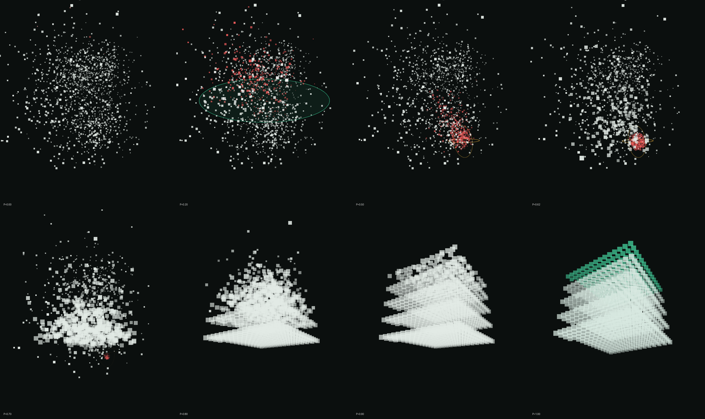

<div align="center">

# Syrin clean

**A faster PC. You just approve.**

An Agent Skill and prompt that lets the AI agent on your computer audit, speed up and clean Windows 10/11 safely, while you only approve in plain words.


[Tiếng Việt](README.vi.md) · [Documentation](docs/index.md) · [Handoff notes](HANDOFF.md) · [Changelog](CHANGELOG.md)

</div>



## Why

Most "PC optimisation" guides tell people to delete Prefetch, clean the registry or turn off Defender. Most AI agents, asked to "clean my PC", improvise commands on a machine they have never seen. This project gives the agent a structured procedure:

- **It measures before it concludes.** Hardware, Windows edition and build, drive type and health, RAM, heat, startup load, error logs and about 50 junk locations, all read-only.
- **You decide, in plain words.** Every proposal says what you gain, what you lose and whether it can be undone. Non-technical users can just type `Approve recommended`.
- **There is always a way back.** A verified restore point, a registry backup, `undo.ps1` per change and a quarantine for personal files.
- **It is cheap to run.** Ready-made scripts, small outputs and staged instructions keep quota use low.

## Features

| | |
|---|---|
| Fully automated | The agent runs every command and elevates itself through one UAC prompt per phase. You never type commands. |
| Hardware-adaptive | Desktop, laptop, 2-in-1, handheld, VM; x64 and ARM64; NVMe, SATA SSD, HDD, eMMC; Intel hybrid, AMD X3D, Snapdragon; Windows 10/11 Home to Enterprise; any Windows display language. |
| Plain-language approval | Six groups (faster, safe cleanup, your call, repair, manual hardware, untouched), sub-codes for single files, natural-language approval in English or Vietnamese, a dry-run confirmation before anything changes. |
| Safety net | Restore point created correctly despite the 24-hour limit and verified, `reg export`, per-code `undo.ps1`, quarantine with manifest, emergency stop rules for failing drives, malware and managed devices. |
| 3D report | `report.html` renders the machine's real junk groups as a 3D cloud sized by measured GB, plus status, proposals and before/after. Works offline. |
| Quota-aware | Big scripts with small output, reuse of bundled scripts, detect-before-scan, retry limits, generated reports, selectable budget and report level. |

## How it works

```
Phase 0  Scan     read-only audit  -> audit.json, health card, report.html
Phase 1  Approve  plain-language proposals with codes, dry run, CONFIRM
Phase 2  Clean    only approved codes, restore point first, before/after report
```

The agent stops after Phase 1 and does nothing until you type `CONFIRM`. `STOP`, `Continue` and `Undo` work at any time.

## Quick start

### Option 1: install the skill (recommended)

1. Download the [English skill](https://github.com/sovergarden-dev/syrin-clean/raw/refs/heads/main/dist/syrin-clean-skill-v3.6-en.zip) (English instructions, replies in your language) or the [Vietnamese skill](https://github.com/sovergarden-dev/syrin-clean/raw/refs/heads/main/dist/syrin-clean-skill-v3.6-vi.zip).
2. Ask your agent:
   > Install the skill from this zip: `<path>`. Extract it to a temporary folder, then run install.ps1 inside it with `powershell -NoProfile -ExecutionPolicy Bypass -File install.ps1`.
3. Start a **new** agent session and send:
   > Use the syrin-clean skill to check, optimise and clean this PC.

First time? Use an audit-only run: the web page has a button that builds that opening message.

### Option 2: use the prompt file (any agent with a terminal)

Save the [English prompt](prompts/syrin-clean-prompt-en-v3.6.md) or [Vietnamese prompt](prompts/syrin-clean-prompt-vi-v3.6.md) on the PC and tell the agent:

> Read the file `<path>` and follow the PROMPT section exactly.

The file embeds the audit script, the 3D report template and the report builder, which the agent extracts instead of retyping.

### Supported agents

Any agent implementing the [Agent Skills](https://agentskills.io) standard.

| Agent | Skills folder |
|---|---|
| Claude Code | `%USERPROFILE%\.claude\skills\` |
| Codex, GitHub Copilot, Cursor, Gemini CLI, OpenCode | `%USERPROFILE%\.agents\skills\` |

`install.ps1` copies the skill into both.

## Customisation

The web pages (`web/`) build the opening message or the full prompt from a profile. Each choice adds one line; the safety rules never change.

Download this repository and open `web/syrin-clean-en-v3.6.html` or `web/syrin-clean-vi-v3.6.html` in a browser. Both pages include the skill download and prompt builder; no server is required.

| Option | Values |
|---|---|
| Main use | auto, gaming, coding/AI/VM, creative, office, laptop, old/weak PC, VM |
| Scope | everything, disk space only, speed only, health check only |
| Cleanup level | balanced, conservative, deep |
| Quota budget | balanced, economical, thorough |
| Autonomy | approve then act, audit only |
| Report | 3D (default), simple, none |
| Extras | target drive for moves, never-touch list, free note |

## Repository layout

```
.
├── skill/
│   ├── vi/                          zip root of the Vietnamese skill: install.ps1, CAI-DAT.txt, syrin-clean/
│   └── en/                          zip root of the English skill: install.ps1, INSTALL.txt, syrin-clean/
├── src/
│   ├── prompt-template.vi.txt       master prompt (Vietnamese), __CUSTOM_CONTEXT__ placeholder
│   └── prompt-template.en.txt       master prompt (English)
├── web/                             landing pages (VI + EN), self-contained, embed the zips
├── prompts/                         generated .md prompts with appendices A/B/C
├── dist/                            release zips of the skill
├── tools/build.py                   rebuilds dist/, web/ and prompts/ from skill/ and src/
├── docs/                            images, history, references
├── HANDOFF.md                       state of the work and how to continue
└── CHANGELOG.md
```

## Bundled scripts

| Script | Purpose |
|---|---|
| `audit.ps1` | Read-only audit; writes `audit.json` and `audit-report.html`; `-Quiet` for agents |
| `run-elevated.ps1` | Runs one script as Admin with a single UAC prompt and waits (exit 1223 = declined) |
| `new-restorepoint.ps1` | Creates and verifies a restore point, temporarily lifting `SystemRestorePointCreationFrequency` |
| `quarantine.ps1` | Preview, `-Apply`, `-Restore`, `-Purge` for personal files, skips OneDrive folders |
| `make-report.ps1` | Builds `report.html` from `audit.json`, `proposals.csv` and an optional baseline (`-Lang vi|en`) |

All scripts target Windows PowerShell 5.1, are saved as UTF-8 with BOM and keep code strings ASCII.

## Build

Requires Python 3.10+ (Node.js optional, used for a JavaScript syntax check).

```bash
python tools/build.py
```

This zips `skill/vi` and `skill/en` into `dist/`, re-embeds the zips, prompt templates, audit script and report template into `web/*.html`, and regenerates `prompts/*.md`.

## Testing

- Open a page with `?check` (for example `web/syrin-clean-en-v3.6.html?check`) and resize with the browser's device toolbar: a panel lists overflow and overlapping text.
- First real run: choose **Audit only** so nothing on the machine changes, then review the chat summary and `report.html`.
- See [HANDOFF.md](HANDOFF.md) for what has and has not been verified.

## Roadmap

- [ ] Field test of all PowerShell scripts on Windows 10 and 11 (x64 and ARM64)
- [ ] Browser QA at 390, 768, 1366, 1920 px with `?check`
- [ ] Signed scripts and a release workflow
- [ ] Monthly read-only health check job as an optional installer

## Contributing

See [CONTRIBUTING.md](CONTRIBUTING.md). Safety rules come first: a change that weakens them will not be merged.

## Acknowledgements

- Design direction informed by [taste-skill](https://github.com/leonxlnx/taste-skill) and [impeccable](https://github.com/pbakaus/impeccable).
- Technical references: Microsoft Learn and Microsoft Support (see the Sources section of the web pages).

## Disclaimer

This project changes system settings only after explicit approval and always creates a way back, but no tool replaces a backup of your own data. Use at your own risk.

## License

[MIT](LICENSE)
