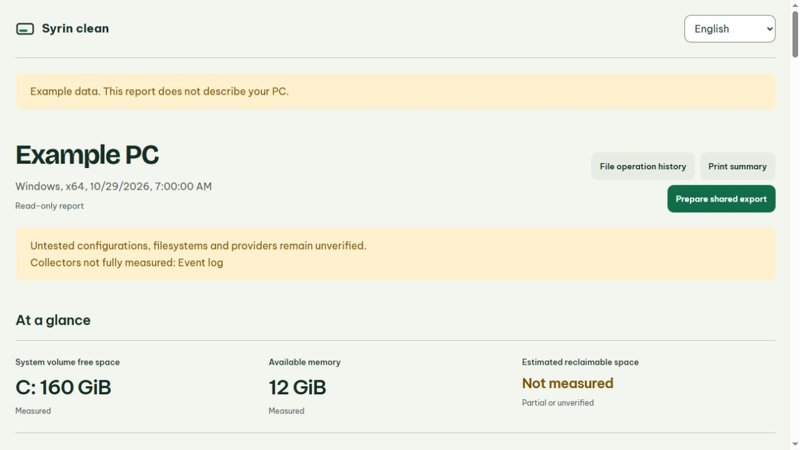

# Syrin clean

**Inspect Windows PCs and Android phones, review the evidence, choose a change.**

This source tree builds the **unreleased 4.1.0-preview.1 candidate**. The public release remains 4.0.0-preview.2. Syrin clean is a bilingual Agent Skill and standalone prompt with a Windows PowerShell runtime and an optional Python Android adapter. Environment qualification remains open.

[Tiếng Việt](README.vi.md) · [Commands](docs/ref/commands.md) · [Support matrix](docs/feat/support.md) · [Validation](docs/ref/validation.md) · [Changelog](CHANGELOG.md)

## Try the report in one minute

Open the [interactive example report](https://sovergarden-dev.github.io/syrin-clean/report-demo.html) to explore EN/VI controls, measurement limits and file history before installing anything. It uses synthetic data, does not scan your PC and does not execute file operations.

[Guided demo and first audit](docs/ref/demo.md) · [Ask a question](https://github.com/sovergarden-dev/syrin-clean/discussions/categories/q-a) · [Report a reproducible bug](https://github.com/sovergarden-dev/syrin-clean/issues)



## What it does

- Collects Windows, storage, memory, startup, event, security and hardware metadata through bounded read-only collectors.
- Preserves complete, partial, unavailable and failed states. Missing data never becomes a healthy zero.
- Separates caches, application data, personal files, virtual disks and system data. Measured size is not promised reclaimable space.
- Plans exact files before quarantine, restore or purge. Execution requires the reviewed plan digest and explicit item IDs; people can approve short plan-local codes through the agent.
- Keeps an owned journal, file identity checks, conflict states and recovery history. Purge deletes only the selected stored files, never a directory tree or unlisted data.
- Builds offline bilingual reports, compatible before/after comparisons and aggregate exports that omit raw private fields.
- Shows audit progress and provides paginated access to every loaded history item; decorative animation has a bounded draw rate.

Automatic mutation is limited to the file lifecycle implemented by the runtime. System tuning, repair, uninstall and hardware suggestions remain advisory until a tested adapter/procedure is available. Quarantine is not a backup and does not free space; purge is separate and irreversible. Read the [support and qualification boundaries](docs/feat/support.md).

## Android and execution controls

Android USB diagnostics collect bounded, read-only storage, memory, CPU and battery metadata. App inventory and per-app frame counters are optional. Use Python 3.10+ and official Google SDK Platform Tools on the Windows host; select the exact phone serial. This preview does not change apps, settings or files on Android and does not support iPhone/iPad.

Windows adds persistent protected paths/audit-only policy, cooperative stop requests, quarantine metadata checks and time-series CPU/memory diagnostics. Reports show measurement age and constrained comparisons. See [device support and controls](docs/feat/devices.md) and the [commands](docs/ref/commands.md).

## Start with an audit

1. Download the [English package](dist/syrin-clean-skill-v4.1.0-preview.1-en.zip) or [Vietnamese package](dist/syrin-clean-skill-v4.1.0-preview.1-vi.zip) from this branch, or build them locally.
2. Ask your agent to verify the package and run `install.ps1` with Windows PowerShell 5.1. The installer stages and validates both agent locations before switching them; previous versions remain outside the discovery folders under `%USERPROFILE%\.syrin-clean-installer`.
3. Start a new agent session and ask: **Use the syrin-clean skill to audit this PC and prepare proposals only.**
4. Review the evidence and uncertainty. For any supported file action, review the exact plan and confirm only the selected codes. Do not approve a personal-file or purge operation through a vague blanket instruction.

The installer writes `.claude/skills/syrin-clean` and `.agents/skills/syrin-clean`. Installation is tested; discovery and end-to-end behavior of each agent/version still require qualification. No system cleanup runs during installation.

## Standalone prompt and web pages

Use the [English prompt](prompts/syrin-clean-prompt-en-v4.1.0-preview.1.md) or [Vietnamese prompt](prompts/syrin-clean-prompt-vi-v4.1.0-preview.1.md) with an agent that can run terminal commands. Read the PROMPT section, then extract the bootstrap/runtime appendix with filesystem commands; do not paste Base64 into model context. The extractor checks the digest, blocks path traversal and only writes a new empty runtime directory. It does not execute cleanup. Both channels use the same packaged helpers and safety policy.

Open the [web app](https://sovergarden-dev.github.io/syrin-clean/) or download the [single offline HTML](dist/syrin-clean.html). English is the default; switch to Vietnamese without losing the profile. Both packages, prompt generation, fonts and the [synthetic report](dist/syrin-clean-report-demo.html) are embedded. The page does not execute Windows commands. GitHub release assets download as files; the Pages link opens the hosted application.

Generated reports also switch EN/VI in place, preserve file selections across pages and filters, and offer a print summary. Original records retain their source language. The optional visual uses measured categories and has an equivalent labeled table.

## Data and privacy

Sessions default to `%LOCALAPPDATA%\SyrinClean\Sessions`; quarantine defaults to `%LOCALAPPDATA%\SyrinClean\Quarantine`. Custom storage must be local, owned and separate from the selected files. Transfers remain on the same volume. Unknown cloud-provider locations and untested filesystems need separate review.

The runtime reads metadata and its own/configuration records, not personal document contents, browser secrets or credentials. It does not upload results. Your agent/provider may process terminal output outside the machine. Raw reports and plans can contain private paths; never commit or share them by accident. `make-report.ps1 -Share -NoOpen` creates a local aggregate export for review, not guaranteed anonymization.

## Development

Python 3.10+, Node.js 22+ and Windows PowerShell 5.1 are required for the full validation flow. No package-manager dependencies are needed.

```powershell
python -B -X utf8 tools/build.py
powershell.exe -NoProfile -NonInteractive -ExecutionPolicy Bypass -File tests/run.ps1
```

`python tools/build.py --check` validates without changing files. Packaging uses an explicit allowlist, manifests, checksums and deterministic ZIP metadata. The same checks run in the [Windows CI workflow](.github/workflows/check.yml). When a release is published, the [Pages workflow](.github/workflows/pages.yml) validates that tag through the same Windows suite, transfers its staged HTML as an artifact, checks the published release digests and publishes only the public site and deployment metadata. Releases are explicitly published with the verified assets; raw machine reports are excluded.

| Canonical source | Responsibility |
|---|---|
| `src/runtime/modules/` | Filesystem, journal, collectors, report validation and Windows adapters |
| `src/runtime/scripts/` | Public command entry points |
| `src/instructions/{en,vi}/` | One policy and phase set per language, shared by skill and prompt |
| `src/report/` | Report template, data model, rendering and styles |
| `src/web/` | Unified bilingual landing template, logic and locale/profile text |
| `src/shared/` | Shared tokens, licensed embedded fonts and bounded canvas rendering |
| `project.json` | Version, channel and public destinations |
| `src/install.ps1`, `src/extract-runtime.ps1` | Transactional installation and standalone extraction |
| `tools/build.py` | Generate and validate all delivery formats |

`skill/`, `web/`, `prompts/`, `dist/`, `src/prompt-template.*.txt` and `src/runtime/assets/report-template.html` are generated. Edit their canonical sources, then build. Do not patch an embedded script or ZIP independently.

See [architecture](docs/arch/project.md), [execution contracts](docs/arch/execution.md), [handoff](HANDOFF.md), [contributing](CONTRIBUTING.md) and [security](SECURITY.md). Historical reference material remains under `docs/history` and `docs/references`.

## License

[MIT](LICENSE). Existing attribution is retained. Design references from the original handoff are documented in [references](docs/references/README.md).
